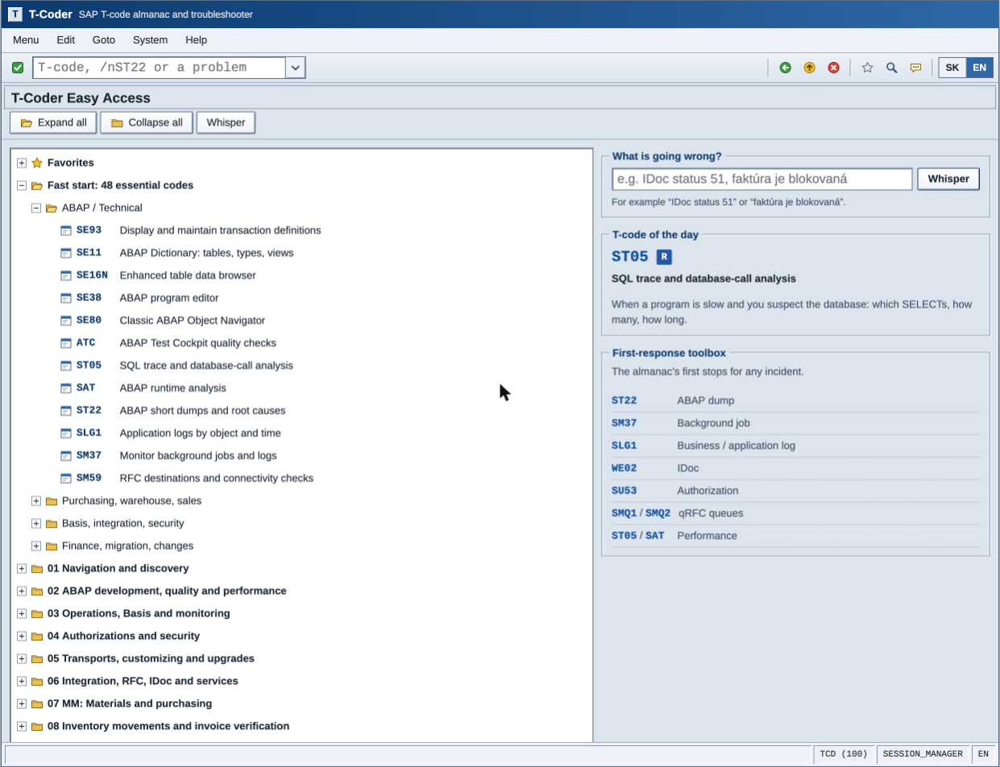
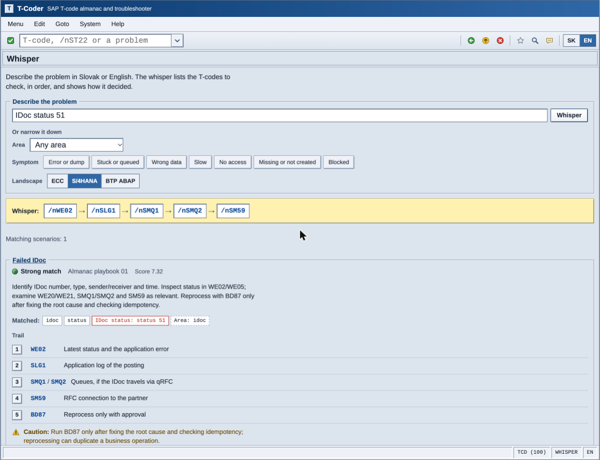
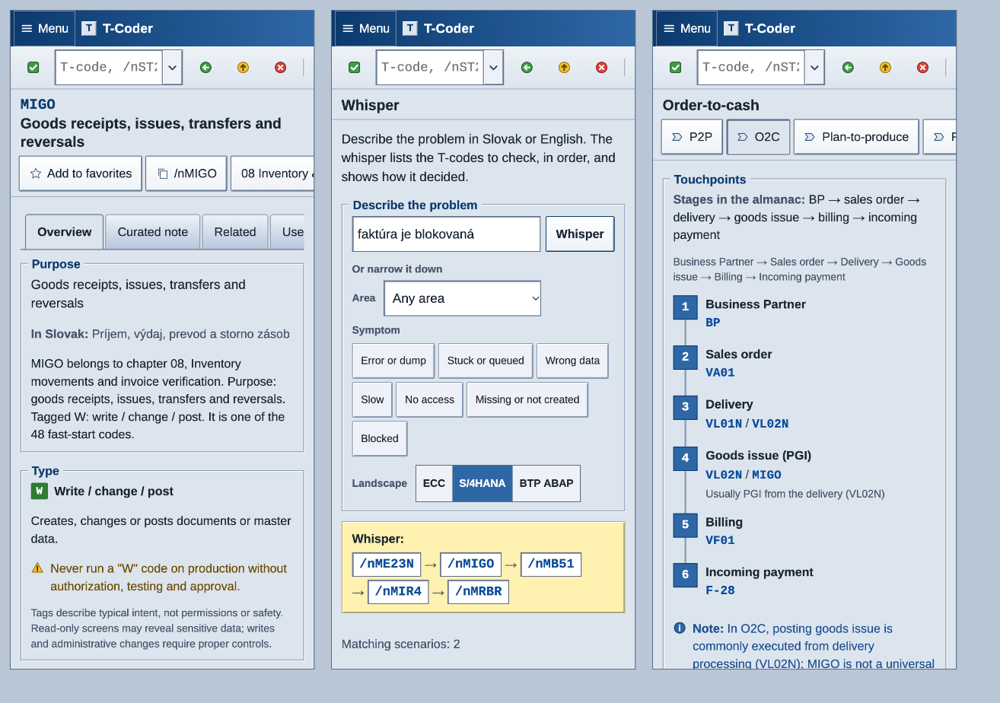

# T-Coder

**A pocket SAP T-code almanac and troubleshooter, in Slovak and English, dressed as a classic SAP GUI session.**

T-Coder lets SAP developers and consultants browse 393 curated transaction codes and describe a problem in plain words (*“IDoc status 51”*, *“faktúra je blokovaná”*). It answers with the T-codes to check, in order, and shows exactly why. No install, no account, no server, no AI: it is a static web app that works offline after the first visit.



| Whisper | On a phone |
| --- | --- |
|  |  |

## Features

- **SAP-style command field.** `SE16N`, `se16n` and `/nSE16N` open a code; `/n` returns to the start menu; `/oVA03` opens a new session (tab); namespaced codes work (`/n/SCWM/MON`). An unknown code gets the familiar red status-bar message, *Transaction XYZ does not exist*, with “did you mean” suggestions. Free text becomes a search. A ▼ button holds the command history, and `Ctrl+/` jumps to the field, as in SAP GUI.
- **Easy Access tree.** Favorites, the almanac’s 48 fast-start codes, the 18 areas and recent codes. It works by tap or with the arrow keys (WAI-ARIA tree). The side panel holds a T-code of the day, a quick whisper and the first-response toolbox.
- **ALV-style lists.** These have a light-blue key column, zebra rows, sortable headers, type and area filters, and a yellow totals band. Below 640 px they become cards.
- **T-code detail.** Each code has four tabs:
  - Overview: the purpose in both languages, what the type tag means, a safety rule, command-field forms with copy buttons, area context and how to verify the code in your own system.
  - Curated note, for 81 key codes.
  - Related: create/change/display siblings, codes often used together and codes from the same area.
  - Used in: which playbooks, scenarios and processes include the code.
  Legacy codes also show their S/4HANA replacement.
- **Whisper (troubleshooter).** It covers 61 problem scenarios: the almanac’s 10 playbooks plus 51 curated ones. For each match it shows a traffic-light confidence, matched-term chips, an ordered trail with a reason for every step, and one combined command chain (`/nWE02 → /nSLG1 → /nSMQ1 …`). Guided chips (area and symptom) work without typing. A landscape lens covers three cases:
  - ECC
  - S/4HANA, which swaps legacy steps such as RSA7 → ODQMON and MB1A → MIGO
  - BTP ABAP, which shows a “no SAP GUI, use ADT” notice
- **Processes.** P2P, O2C, plan-to-produce, R2R and migration readiness. They show as chevron flows on desktop and a vertical stepper on phones.
- **Reference.** Type tags, the command field, data keys and tables, movement types, S/4HANA changes and sources.
- **Self-test.** The almanac’s 20 interview-style questions as flashcards, with model answers.
- **Bilingual UI.** SK/EN switches with one tap. The default comes from the browser language (sk/cs → Slovak), and `<html lang>` follows the choice.
- **PWA, private by design.** Favorites, recent codes and history stay in `localStorage`. Nothing leaves the device.

## How the whisper works

The engine (`src/engine/whisper.ts`) is deterministic and explainable: every point of a score maps to a chip in the UI.

1. **Normalise.** The query is lower-cased and diacritics are removed (`Faktúra` → `faktura`). Code punctuation inside tokens is kept (`/SCWM/MON`, `F-28`, `F.01`). Slovak and English stopwords are dropped. Adjacent words form bigrams for phrase terms.
2. **Match terms.** Each scenario has *signals*, which are groups of synonyms with a weight. A query word matches a term in one of three ways:
   - **exactly** (score 1.0)
   - **by prefix or shared stem** (0.8): both words have at least 4 letters, which absorbs Slovak endings such as *faktúra / faktúru / faktúry*
   - **with one typo** (0.6): Damerau–Levenshtein distance ≤ 1, both words at least 5 letters
   Words that contain digits only match exactly, so ME21N never “almost” matches ME22N. A signal counts once, through its best term, weighted by `w × idf`. That way synonyms don’t stack and rare terms weigh more.
3. **Error signatures.** Regex patterns recognise messages such as `status 51`, `TIME_OUT|MESSAGE_TYPE_X|DBSQL_*`, `locked by …` and `not open`.
4. **Literal T-codes.** A code typed in the query boosts every scenario whose trail contains it, and the code is shown as a card. A legacy code (XD01, MB1A, LTMC, RSA7…) boosts the *legacy in S/4HANA* scenario, which puts the almanac’s replacement first.
5. **Area keywords** (`idoc`, `ewm`, `mm`…) add a small bonus.
6. **Coverage.** Each score is multiplied by `0.5 + 0.5 × (share of query words explained)`.
7. **Combined ranking.** `Σ score × 1 / (1 + 0.35 · stepIndex)` across all matches gives the one-line command chain.
8. **Fallback.** With no match above the threshold, the almanac’s first-response toolbox appears (ST22, SM37, SLG1, WE02, SU53, SMQ1/SMQ2, ST05/SAT), along with plain search results.

Golden queries in `tests/whisper.test.ts` pin the behaviour in both languages. For example, *používateľ nemá oprávnenie* → missing authorization, *ERP and EWM stock differ* → ERP vs EWM mismatch, *XD01 in S/4* → BP, and *banana* → toolbox.

## Data provenance

The source is the author’s bilingual reference *SAP T-Code Almanach SK/EN* (edition of 23 Oct 2026, 40 pages).

```
almanac PDF ──(macOS PDFKit via osascript)──▶ data/raw/almanach.txt   (committed)
            npm run data:extract

almanach.txt ──(parser + self-checks)──▶ src/data/generated/catalog.json (committed)
             npm run data:build
```

`scripts/build-catalog.ts` parses the code rows and fails the build unless the result agrees with every total the almanac states about itself:

- 393 unique codes,
- all 18 per-chapter counts (15, 23, 32, …),
- type totals R 123 / W 134 / A 89 / O 30 / L 17,
- the alphabetical index: the same code set, each code in the same chapter.

CI re-runs the parser and fails if the committed catalog drifts. The smaller, irregular pages are transcribed by hand into `src/data/`: area intros, fast start, playbooks, processes, keys, movement types, S/4 changes and quiz questions.

**Curated content** comprises 81 notes, 51 scenarios and 20 quiz model answers. It was written for T-Coder and is labelled as such in the UI. It is deliberately conservative: it says where to look, never how to intervene in production. Every note carries `reviewed: false` until the author has checked it. **Review the curated content before showing the app publicly.**

## Architecture

Vite + TypeScript (strict, with `noUncheckedIndexedAccess` and `exactOptionalPropertyTypes`), no framework.

```
scripts/        extract-pdf.mjs · build-catalog.ts · make-icons.mjs (dependency-free PNG encoder)
src/
  data/         catalog (generated) · areas · archetypes · notes · processes · reference · replacements · quiz
  engine/       normalize · fuzzy · search · command · related · explain · whisper · daily   ← pure, unit-tested
  i18n/         en.ts · sk.ts (typed against en, so a missing translation fails to compile)
  ui/           dom.ts (tiny hyperscript; text is never parsed as HTML) · shell.ts (window chrome)
                components/ (tree, ALV grid, tab strip, flow, group box) · views/ (one per route)
  styles/       tokens.css · chrome.css · components.css · views.css
tests/          129 Vitest tests: engines, golden queries, content integrity, router/state, WCAG contrast
```

Hash routes make every screen deep-linkable from any static host. Examples: `#/t/%2FSCWM%2FMON`, `#/whisper?q=…&area=06&symptom=stuck`, `#/process/o2c`, `#/ref/keys`.

## Design

The look is a late-90s SAP GUI “Enjoy”-era session, rebuilt from scratch:

- a dark-blue title bar, a menu bar that collapses to a single Menu on phones, and a system toolbar with the command field;
- bevelled controls, group boxes with the title set into the frame, and tab strips;
- ALV grids and a segmented status bar with S/W/E/I message icons.

Type is set in **Arimo** (Arial-metric) for the UI and **Cousine** (Courier-New-metric) for codes and lists. Both are self-hosted through `@fontsource` with Latin-ext for Slovak. All icons are original inline SVGs. No SAP assets, logos or fonts are used.

Accessibility:

- 44 px touch targets on touch devices; denser metrics when a mouse is present;
- keyboard support for the tree, tabs and menus;
- an `aria-live` status bar, and focus moves to the new screen title on navigation;
- `prefers-reduced-motion` is respected;
- a test (`tests/contrast.test.ts`) checks the palette against WCAG AA.

## Run it

Requirements: Node ≥ 22.18. No other tooling is needed; macOS is only required to re-extract the PDF.

```bash
npm install
npm run dev          # http://localhost:5173
npm test             # Vitest
npm run typecheck    # tsc --noEmit
npm run build        # type-check + production build into dist/
npm run preview      # serve dist/ locally

npm run data:extract # re-extract the PDF (macOS; path via argument or ALMANAC_PDF)
npm run data:build   # re-parse and verify the catalog
npm run icons        # regenerate the PWA icons
```

## Deploy

`.github/workflows/deploy.yml` re-checks the catalog, runs the tests, builds, and publishes `dist/` to GitHub Pages on every push to `main`. To deploy:

1. Create a GitHub repository and push this project.
2. In the repository settings, under **Pages**, set the source to **GitHub Actions**.

The build uses relative paths (`base: './'`), so it also runs unchanged on Netlify, Cloudflare Pages or any static file server.

Before publishing, fill in your name and links in `src/config.ts` and the copyright line in `LICENSE`.

## Disclaimer

Independent learning project, not affiliated with SAP SE. SAP, SAP GUI, S/4HANA and Fiori are trademarks of SAP SE. Transaction availability depends on product, release, components and authorizations; always verify codes in your own system.

## License

Source code: MIT (see `LICENSE`). Almanac content: © the author.
